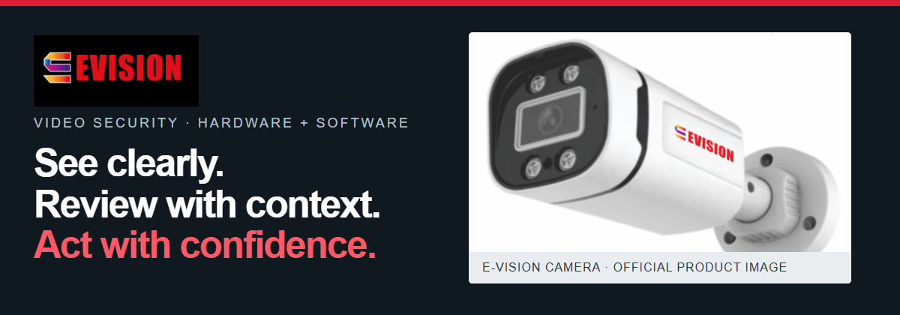
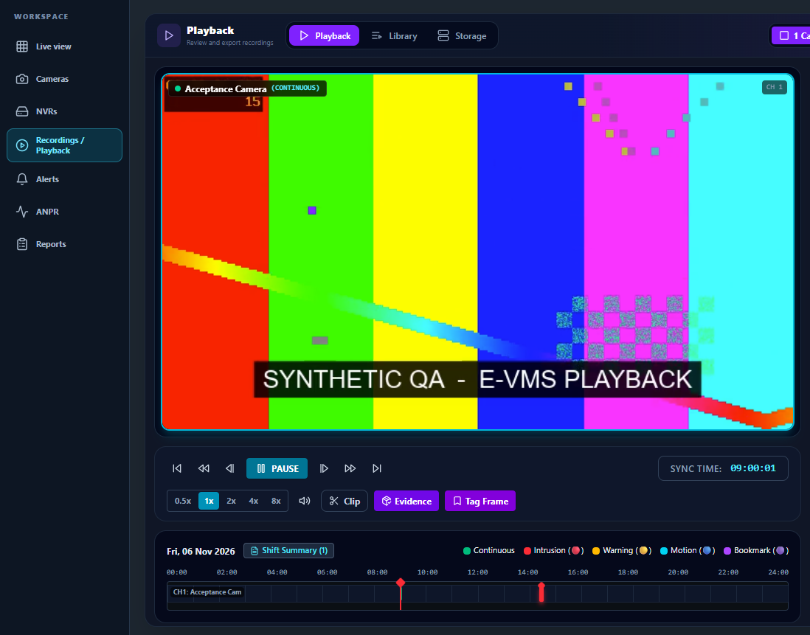
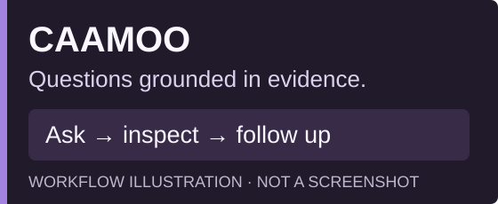
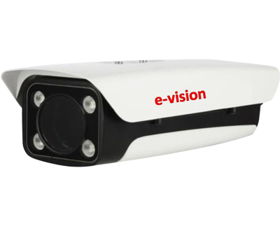
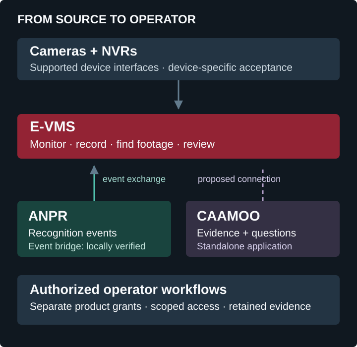
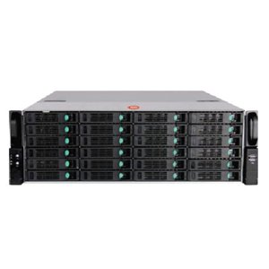

  

# E-Vision India

### Video security, from the camera to the investigation.

We bring together **CCTV cameras, recording systems, video software and technical support** to help teams monitor their spaces and review what happened. From equipment selection and system integration to installation guidance and ongoing support, our work connects the field device with the people who use it.

**[Explore E-Vision ↗](https://evisionindia.com/)** · **[Hardware catalogue](https://evisionindia.com/cctv-cameras/)** · **[Discuss your project](https://evisionindia.com/contact-us/)**

[Solutions](#solutions) · [Software](#software-for-the-operator) · [Ecosystem](#how-the-products-fit-together) · [Gallery](#a-closer-look) · [Contact](#lets-plan-your-system)

## Solutions

| | What we help you put together |
|---|---|
| 📷 **Capture & record** | CCTV and IP cameras, PTZ options, DVR/NVR recording and supporting network equipment. |
| 🖥 **Operate & investigate** | Video management, footage review, evidence-led investigation and number-plate event workflows. |
| 🛠 **Integrate & support** | System selection, installation guidance, security consulting and technical support for the intended site. |

Explore [cameras](https://evisionindia.com/cctv-cameras/), [recording systems](https://evisionindia.com/video-recorder/) and [company services](https://evisionindia.com/about-us/). Equipment and scope are selected for the project rather than assumed from a demonstration.

## Software for the operator

### 01 / E-VMS — Monitor. Record. Review.

**A workspace for camera operations and recorded footage.** Organize cameras and NVRs, configure recording storage, find footage on a timeline and review or export permitted clips.

*Screen: real application interface with a synthetic demonstration recording.* The managed Windows operator client connects to a separately provisioned server; Platform Owner remains a separate privileged product.

[Product website source & release details ↗](https://github.com/Evisionindia/EVMS-website) · [Discuss an E-VMS demonstration](https://evisionindia.com/contact-us/)

---

### 02 / CAAMOO — Ask a question. Inspect the evidence.

**A separate visual investigation application.** Ask questions about approved material, continue the conversation, revisit saved history and open the supporting evidence or export permitted results.

*Workflow illustration; application screenshots are not included in this public presentation.* CAAMOO is separately licensed; ask the team about availability and the intended evidence sources.

[Request a CAAMOO demonstration ↗](https://evisionindia.com/contact-us/)

---

### 03 / ANPR — Find the event behind the plate.

**Number-plate event processing and review.** Search observations, inspect plate crops and follow an event to its evidence. Product access and the E-VMS event bridge have separate configuration boundaries.

*Official ANPR-category product photograph; it does not measure roadside recognition accuracy.* Local event exchange with E-VMS has been verified; device and site acceptance remain specific to the installation.

[ANPR hardware options](https://evisionindia.com/cctv-cameras/) · [Discuss ANPR software ↗](https://evisionindia.com/contact-us/)

## How the products fit together

**Implemented:** supported camera/NVR workflows in E-VMS. **Locally verified:** ANPR event exchange with E-VMS. **Proposed:** a direct E-VMS–CAAMOO connection. Each application retains its own access and product-grant boundary.

## A closer look

<table>
<tr>
<td width="50%" align="center"> <strong>Camera options</strong> Official E-Vision catalogue image</td>
<td width="50%" align="center"> <strong>Recording systems</strong> Official NVR catalogue image</td>
</tr>
</table>

The E-VMS screen above shows an actual interface with synthetic demonstration data; the CAAMOO overview is an illustration. These product photographs are catalogue material, not photographs of a customer deployment. [Image sources and demonstration notes](https://github.com/Evisionindia/.github/blob/main/profile/ASSETS.md).

## From requirements to a usable system

Start with the site, cameras, network, retention needs and operator responsibilities. We can discuss equipment choices, software fit, integration and support around those requirements. A desktop client is one part of the system: server services, storage and device connectivity are planned separately.

**Plan the scope → select the equipment → configure the workflows → verify on the intended site.**

## Let’s plan your system

**[Contact E-Vision India ↗](https://evisionindia.com/contact-us/)** · [info@evisionindia.com](mailto:info@evisionindia.com) · [sales@evisionindia.com](mailto:sales@evisionindia.com)

For technical enquiries: [support@evisionindia.com](mailto:support@evisionindia.com). Visit the [official company website](https://evisionindia.com/) for the current product catalogue and contact details.

E-Vision India company profile. Individual engineering contributions remain credited in the corresponding project histories and notices.
